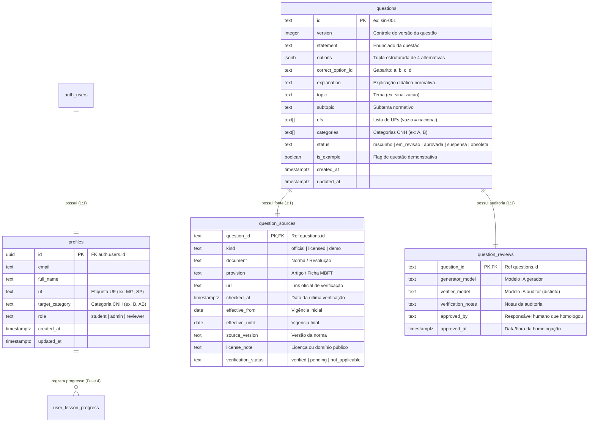
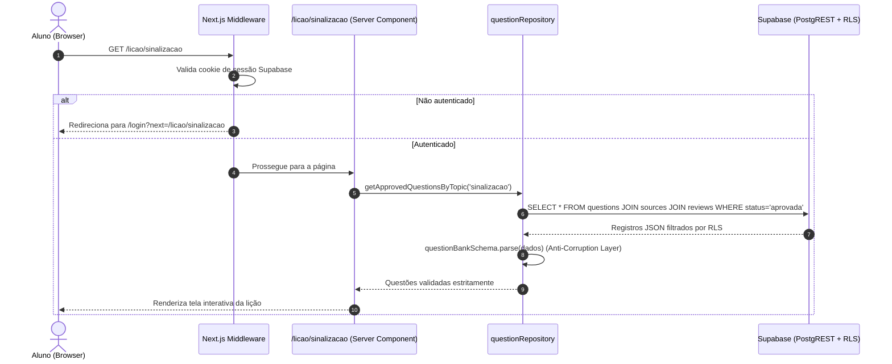

# T003 — Plano Técnico de Implementação: Persistência e Autenticação (Fase 3)

**Projeto:** AprovaCNH
**Diretório:** `C:\Projetos\AprovaCNH`
**Fase:** Fase 3 (T003 — Persistência e Autenticação)
**Status:** PLANEJAMENTO ELABORADO — AGUARDANDO APROVAÇÃO FORMAL (D010)
**Data:** 08/11/2026
**Branch Proposta:** `feat/T003-persistencia-auth`
**Decisões Aplicadas:** D001, D002, D003, D004, D005, D010, D011, D012, D013, D014, D015

---

## 1. Contexto, Objetivos e Critérios de Saída

### 1.1. Contexto
Com a conclusão da **Fase 1 (T001)** — validação da fatia vertical técnica da lição — e da **Fase 2 (T002)** — homologação humana do piloto de 20 questões fundamentadas exclusivamente no MBFT (Resolução CONTRAN nº 985/2022) —, os dados e o estado da aplicação residem em arquivos estáticos locais (`questions-sinalizacao.json` e `seed-sinalizacao.json`). O projeto Supabase já foi criado e suas credenciais públicas (`NEXT_PUBLIC_SUPABASE_URL` e `NEXT_PUBLIC_SUPABASE_ANON_KEY`) já se encontram provisionadas no arquivo `.env.local` na raiz do projeto.

### 1.2. Objetivos da Fase 3 (conforme `FASES.md`)
Substituir o armazenamento estático local pelo **Supabase (PostgreSQL + Supabase Auth)**, estabelecendo:
1. Design de schema relacional que atenda e reforce as regras de negócio definidas no esquema Zod.
2. Migrations declarativas em SQL nativo versionadas e reprodutíveis.
3. Políticas rigorosas de Row Level Security (RLS) garantindo que alunos só acessem questões com status `aprovada` (ou demonstrativas autorizadas).
4. Fluxo de autenticação moderno e acessível (Next.js 16 App Router + `@supabase/ssr`), vinculando cada usuário a um perfil de estudante.
5. Camada de Repositório no servidor que valide os dados oriundos do banco via Zod (`questionSchema.parse()`), operando como *Anti-Corruption Layer*.

### 1.3. Critérios de Saída da Fase 3
- [ ] Aluno consegue criar conta, realizar login e encerrar sessão de forma segura e acessível.
- [ ] Perfil do aluno (`public.profiles`) é criado automaticamente no primeiro cadastro via trigger de banco.
- [ ] Banco de dados contém as 20 questões homologadas da T002 populadas via migration/seed.
- [ ] RLS impede qualquer leitura de questões não aprovadas (`em_revisao`, `suspensa`, `obsoleta`) por alunos comuns e bloqueia qualquer mutação de conteúdo por usuários não autorizados.
- [ ] A rota `/licao/sinalizacao` carrega as questões dinamicamente a partir do Supabase com validação Zod preservada.
- [ ] 100% dos testes unitários, de esquemas, de autorização e E2E aprovados.

---

## 2. Análise do Contrato de Domínio Atual (Zod)

O modelo atual de dados em `src/features/lesson/schemas/questionSchema.ts` estabelece as seguintes invariantes estruturais e regulatórias:

```
Question
├── id: string (identificador único, ex: 'sin-001')
├── version: number (inteiro positivo para controle de versão normativa)
├── statement: string (mínimo 5 caracteres)
├── options: [Option, Option, Option, Option] (exatamente 4 alternativas com IDs 'a', 'b', 'c', 'd')
├── correctOptionId: 'a' | 'b' | 'c' | 'd' (deve coincidir com uma das opções)
├── explanation: string (justificativa pedagógica/normativa obrigatória)
├── topic: string (ex: 'sinalizacao')
├── subtopic?: string (ex: 'Art. 195 - Desobediência')
├── ufs: string[] (UF como etiqueta; proibido 'BR', vazio [] para escopo nacional - D014)
├── categories: string[] (ex: ['A', 'B'])
├── status: 'rascunho' | 'em_revisao' | 'aprovada' | 'suspensa' | 'obsoleta'
├── isExample: boolean (true apenas para rascunhos demonstrativos)
├── source: QuestionSource
│   ├── kind: 'official' | 'licensed' | 'demo'
│   ├── document, provision, url, checkedAt, effectiveFrom, effectiveUntil, sourceVersion, licenseNote
│   └── verificationStatus: 'verified' | 'pending' | 'not_applicable'
└── review?: QuestionReview | null
    ├── generatorModel: string
    ├── verifierModel: string (obrigatoriamente diferente do gerador - D003)
    ├── verificationNotes: string | null
    ├── approvedBy: string (homologador humano responsável)
    └── approvedAt: string (timestamp ISO)
```

---

## 3. Design Relacional das Tabelas (PostgreSQL no Supabase)

### 3.1. Estrutura Proposta e Justificativa

Adotaremos um modelo relacional normalizado que reflete a separação de responsabilidades do domínio:



### 3.2. Justificativa Técnica da Abordagem de `options` (JSONB vs Tabela Filha)
- **Decisão:** Armazenamento das alternativas em coluna `options jsonb` na tabela `questions`, acompanhado de uma `CHECK CONSTRAINT` no PostgreSQL que valida que o array possui exatamente 4 elementos e contém os identificadores `'a'`, `'b'`, `'c'` e `'d'`.
- **Motivo:**
  1. Na prova teórica de CNH, as 4 opções de resposta formam um bloco coeso, imutável e inseparável da questão. Não existe consulta ou relacionamento de uma alternativa isolada fora do contexto da sua respectiva questão.
  2. Evita 4 `JOINs` adicionais a cada leitura de questão no banco, otimizando a latência e o consumo de I/O no tier gratuito do Supabase.
  3. Mantém compatibilidade 1:1 direta com o esquema do Zod (`options: z.tuple([...])`).

### 3.3. Tabela de Perfis (`profiles`)
- Estende a tabela nativa `auth.users` do Supabase.
- A coluna `role` (`student`, `reviewer`, `admin`) permitirá controle de privilégios para mutações futuras e painel administrativo (Fase 8).
- As colunas `uf` e `target_category` preparam o terreno para a personalização do estudo na Fase 4 sem necessidade de refatorações de banco posteriores.

---

## 4. Estratégia de Migrations (Simplicidade e Leveza para o MVP)

### 4.1. Análise Comparativa de Ferramental

| Abordagem | Prós | Contras | Avaliação para MVP |
|---|---|---|---|
| **Prisma ORM** | Schema declarativo centralizado, autocompletion | Pacote pesado (~50MB), gera binários nativos (`query-engine`), exige conexão de banco direta via pooler (porta 6543/5432) incompatível com a chave Anon HTTP do Supabase, suporte complexo e imperfeito para RLS nativo e triggers de `auth.users`. | **Rejeitado:** Viola a regra de dependências mínimas e simplicidade (D001, AGENTS.md regra 4). |
| **Drizzle ORM** | Mais leve que Prisma, tipagem estrita | Exige configuração de driver PostgreSQL e mapeamento redundante dos esquemas Zod existentes. | **Rejeitado:** Camada intermediária desnecessária para o volume de dados do MVP. |
| **SQL Nativo Versionado (`supabase/migrations/*.sql`)** | **100% nativo do Supabase**, zero dependências adicionais no bundle, controle total de RLS, triggers e constraints do PostgreSQL, executável via Supabase Dashboard SQL Editor ou Supabase CLI. | Requer escrita de DDL em SQL padrão. | **ESCOLHA RECOMENDADA:** Máxima simplicidade, transparência e aderência à stack aprovada. |

### 4.2. Estrutura de Arquivos de Migration
```
supabase/
├── migrations/
│   └── 20261108000000_create_initial_schema.sql  (Schema DDL, Constraints, Triggers e RLS)
└── seed.sql                                      (Carga inicial das 20 questões homologadas da T002)
```

### 4.3. Script SQL Proposto (`20261108000000_create_initial_schema.sql`)

```sql
-- 1. Extensões e Tipos
CREATE EXTENSION IF NOT EXISTS "uuid-ossp";

-- 2. Tabela de Perfis de Usuário (vinculada a auth.users)
CREATE TABLE public.profiles (
    id UUID PRIMARY KEY REFERENCES auth.users(id) ON DELETE CASCADE,
    email TEXT NOT NULL,
    full_name TEXT,
    uf TEXT CHECK (uf IS NULL OR (length(uf) = 2 AND uf <> 'BR')),
    target_category TEXT CHECK (target_category IS NULL OR target_category IN ('A', 'B', 'AB', 'C', 'D', 'E')),
    role TEXT NOT NULL DEFAULT 'student' CHECK (role IN ('student', 'reviewer', 'admin')),
    created_at TIMESTAMPTZ NOT NULL DEFAULT timezone('utc'::text, now()),
    updated_at TIMESTAMPTZ NOT NULL DEFAULT timezone('utc'::text, now())
);

-- Trigger para criar perfil automaticamente ao registrar novo usuário no Supabase Auth
CREATE OR REPLACE FUNCTION public.handle_new_user()
RETURNS trigger AS $$
BEGIN
    INSERT INTO public.profiles (id, email, full_name, role)
    VALUES (
        new.id,
        new.email,
        coalesce(new.raw_user_meta_data->>'full_name', ''),
        'student'
    );
    RETURN new;
END;
$$ LANGUAGE plpgsql SECURITY DEFINER;

CREATE OR REPLACE TRIGGER on_auth_user_created
    AFTER INSERT ON auth.users
    FOR EACH ROW EXECUTE FUNCTION public.handle_new_user();

-- 3. Tabela de Questões
CREATE TABLE public.questions (
    id TEXT PRIMARY KEY,
    version INTEGER NOT NULL DEFAULT 1 CHECK (version > 0),
    statement TEXT NOT NULL CHECK (length(statement) >= 5),
    options JSONB NOT NULL,
    correct_option_id TEXT NOT NULL CHECK (correct_option_id IN ('a', 'b', 'c', 'd')),
    explanation TEXT NOT NULL CHECK (length(explanation) > 0),
    topic TEXT NOT NULL CHECK (length(topic) > 0),
    subtopic TEXT,
    ufs TEXT[] NOT NULL DEFAULT '{}'::text[],
    categories TEXT[] NOT NULL DEFAULT '{}'::text[],
    status TEXT NOT NULL CHECK (status IN ('rascunho', 'em_revisao', 'aprovada', 'suspensa', 'obsoleta')),
    is_example BOOLEAN NOT NULL DEFAULT false,
    created_at TIMESTAMPTZ NOT NULL DEFAULT timezone('utc'::text, now()),
    updated_at TIMESTAMPTZ NOT NULL DEFAULT timezone('utc'::text, now()),

    -- Invariante D014: Proibido 'BR' como código de UF
    CONSTRAINT check_no_br_in_ufs CHECK (NOT ('BR' = ANY(ufs))),

    -- Invariante de integridade das opções: deve ser array de 4 itens
    CONSTRAINT check_options_length CHECK (jsonb_typeof(options) = 'array' AND jsonb_array_length(options) = 4)
);

-- 4. Tabela de Fontes Regulatórias (D003)
CREATE TABLE public.question_sources (
    question_id TEXT PRIMARY KEY REFERENCES public.questions(id) ON DELETE CASCADE,
    kind TEXT NOT NULL CHECK (kind IN ('official', 'licensed', 'demo')),
    document TEXT,
    provision TEXT,
    url TEXT,
    checked_at TIMESTAMPTZ,
    effective_from DATE,
    effective_until DATE,
    source_version TEXT,
    license_note TEXT,
    verification_status TEXT NOT NULL CHECK (verification_status IN ('verified', 'pending', 'not_applicable'))
);

-- 5. Tabela de Auditoria e Homologação Editorial (D003, D011)
CREATE TABLE public.question_reviews (
    question_id TEXT PRIMARY KEY REFERENCES public.questions(id) ON DELETE CASCADE,
    generator_model TEXT,
    verifier_model TEXT,
    verification_notes TEXT,
    approved_by TEXT,
    approved_at TIMESTAMPTZ,

    -- Invariante D003: modelo verificador deve ser distinto do gerador
    CONSTRAINT check_different_models CHECK (
        generator_model IS NULL OR verifier_model IS NULL OR generator_model <> verifier_model
    )
);

-- Índices de consulta otimizada
CREATE INDEX idx_questions_status_topic ON public.questions (status, topic);
CREATE INDEX idx_questions_ufs ON public.questions USING gin (ufs);
CREATE INDEX idx_questions_categories ON public.questions USING gin (categories);
```

---

## 5. Políticas de Segurança (Row Level Security - RLS)

Todas as tabelas terão RLS ativado por padrão (`DEFAULT DENY`), expondo apenas o que for estritamente necessário:

```sql
-- Habilitar RLS em todas as tabelas públicas
ALTER TABLE public.profiles ENABLE ROW LEVEL SECURITY;
ALTER TABLE public.questions ENABLE ROW LEVEL SECURITY;
ALTER TABLE public.question_sources ENABLE ROW LEVEL SECURITY;
ALTER TABLE public.question_reviews ENABLE ROW LEVEL SECURITY;

-- 1. Políticas de PROFILES
-- Usuário autenticado pode ler apenas o seu próprio perfil
CREATE POLICY "profiles_select_own"
    ON public.profiles FOR SELECT
    TO authenticated
    USING (auth.uid() = id);

-- Usuário autenticado pode atualizar apenas o seu próprio perfil
CREATE POLICY "profiles_update_own"
    ON public.profiles FOR UPDATE
    TO authenticated
    USING (auth.uid() = id)
    WITH CHECK (auth.uid() = id);

-- 2. Políticas de QUESTIONS
-- Alunos (autenticados) só podem ler questões APROVADAS (ou demonstrativas autorizadas)
CREATE POLICY "questions_select_student"
    ON public.questions FOR SELECT
    TO authenticated, anon
    USING (
        status = 'aprovada'
        OR (is_example = true AND status = 'rascunho')
    );

-- Escrita bloqueada para usuários comuns; apenas admin pode modificar
CREATE POLICY "questions_admin_all"
    ON public.questions FOR ALL
    TO authenticated
    USING (
        EXISTS (
            SELECT 1 FROM public.profiles
            WHERE profiles.id = auth.uid() AND profiles.role = 'admin'
        )
    );

-- 3. Políticas de QUESTION_SOURCES e QUESTION_REVIEWS
-- Leitura permitida se a questão associada for legível pelo aluno
CREATE POLICY "sources_select_student"
    ON public.question_sources FOR SELECT
    TO authenticated, anon
    USING (
        EXISTS (
            SELECT 1 FROM public.questions
            WHERE questions.id = question_sources.question_id
            AND (questions.status = 'aprovada' OR (questions.is_example = true AND questions.status = 'rascunho'))
        )
    );

CREATE POLICY "reviews_select_student"
    ON public.question_reviews FOR SELECT
    TO authenticated, anon
    USING (
        EXISTS (
            SELECT 1 FROM public.questions
            WHERE questions.id = question_reviews.question_id
            AND (questions.status = 'aprovada' OR (questions.is_example = true AND questions.status = 'rascunho'))
        )
    );
```

---

## 6. Arquitetura e Fluxo de Autenticação (Next.js 16 App Router)

### 6.1. Pacotes Mínimos e Justificativa
Para suportar Supabase no Next.js App Router com segurança de cookies e SSR:
- `@supabase/supabase-js`: Cliente oficial de comunicação com a API REST / PostgREST do Supabase.
- `@supabase/ssr`: Gerenciador oficial de cookies para Next.js App Router (Server Components, Server Actions e Route Handlers).

### 6.2. Estrutura de Código Proposta
```
src/
├── lib/
│   └── supabase/
│       ├── client.ts         (createBrowserClient para Client Components)
│       ├── server.ts         (createServerClient usando cookies() do Next.js)
│       └── middleware.ts     (atualização e refresh transparente do token de sessão)
├── middleware.ts             (Next.js root middleware para proteção de rotas privadas)
├── app/
│   ├── (auth)/
│   │   ├── login/page.tsx    (Formulário de login acessível e semântico)
│   │   ├── cadastro/page.tsx (Formulário de cadastro com validação de senha)
│   │   └── layout.tsx        (Layout limpo para fluxos de autenticação)
│   └── auth/
│       ├── callback/route.ts (Route Handler para troca do código PKCE por sessão)
│       └── signout/route.ts  (Route Handler para encerramento de sessão)
└── features/
    └── lesson/
        └── server/
            └── questionRepository.ts (Camada de acesso a dados no servidor com validação Zod)
```

### 6.3. Fluxo de Execução da Lição Autenticada


---

## 7. Estratégia de Testes da Fase 3

| Tipo de Teste | Alvo / Escopo | Critério de Sucesso |
|---|---|---|
| **Unitário (Schemas e Repository)** | `tests/unit/questionRepository.test.ts` | Validação de que erros de banco ou dados corrompidos são interceptados pelo Zod antes da UI; teste de fallbacks. |
| **Integração / Componentes** | `tests/components/AuthForms.test.tsx` | Validação de acessibilidade (ARIA labels, estados de erro acessíveis, foco por teclado) nos formulários de login e cadastro. |
| **Ponta a Ponta (E2E)** | `tests/e2e/auth-flow.spec.ts` | Execução pelo Playwright de fluxo completo: cadastro/login de usuário teste -> acesso à rota `/licao/sinalizacao` -> resolução da lição -> verificação de logout. |
| **Regressão** | `pnpm test` e `pnpm test:e2e` | 100% dos testes existentes das fases T001 e T002 continuam aprovados sem nenhuma regressão. |

---

## 8. Pontos para Avaliação e Decisão do Tech Lead

Antes de escrever qualquer código ou criar tabelas reais no projeto Supabase, submetemos os seguintes pontos para alinhamento:

1. **Acesso Público vs Restrito para Demonstração:**
   - *Proposta:* A lição de demonstração (`/licao/sinalizacao` com as 5 questões demonstrativas de T001) pode permanecer pública (acessível sem login), enquanto o banco oficial de 20 questões homologadas da T002 e a persistência de progresso exigem autenticação do aluno.
2. **Métodos de Autenticação no MVP:**
   - *Proposta:* Iniciar apenas com **E-mail + Senha** simples (com confirmação de e-mail desativada em ambiente de desenvolvimento local para agilizar os testes E2E, e ativação de Magic Link ou Google OAuth em fases futuras).
3. **Localização das Migrations:**
   - *Proposta:* Manter o script DDL em `supabase/migrations/20261108000000_create_initial_schema.sql` e a carga em `supabase/seed.sql` versionados no repositório Git.

---

> [!IMPORTANT]
> **Porta de Aprovação D010 — Parada Obrigatória:**
> Nenhuma tabela real foi criada no Supabase, nenhum pacote foi instalado e nenhum código da aplicação web foi modificado.
> O agente está parado e aguarda a revisão e a autorização explícita do Tech Lead para iniciar a implementação da Fase 3 (T003).
