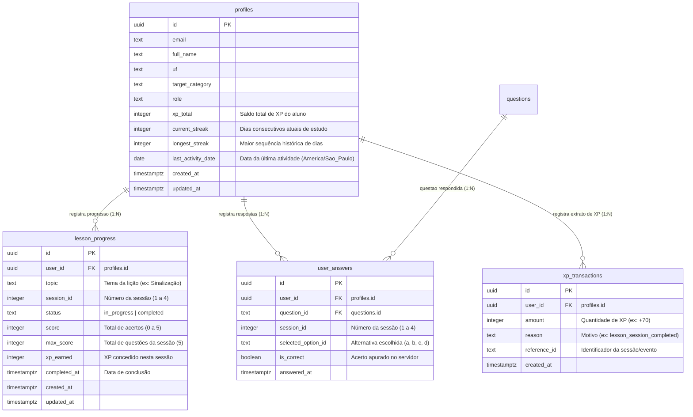

# T004 — Plano Técnico de Implementação: Progresso, XP e Experiência de Aprendizagem (Fase 4)

**Projeto:** AprovaCNH
**Diretório:** `C:\Projetos\AprovaCNH`
**Fase:** Fase 4 (T004 — Progresso, XP e Experiência de Aprendizagem)
**Status:** PLANEJAMENTO ELABORADO — AGUARDANDO APROVAÇÃO FORMAL (D010)
**Data:** 08/11/2026
**Branch Proposta:** `feat/T004-progresso-xp-trilhas`
**Decisões Aplicadas:** D001, D002, D003, D004, D005, D010, D011, D012, D013, D014, D015

---

## 1. Contexto, Objetivos e Critérios de Saída

### 1.1. Contexto
Com a conclusão da **Fase 3 (T003)**, o AprovaCNH possui o banco de dados PostgreSQL estruturado no Supabase, RLS ativo, 20 questões oficiais do MBFT homologadas e persistidas, e autenticação funcional via Next.js App Router e `@supabase/ssr`. No entanto, o progresso do aluno, as respostas submetidas e o saldo de XP ainda são mantidos em memória efêmera no navegador.

### 1.2. Objetivos da Fase 4 (conforme `FASES.md`)
Construir a camada de **experiência de aprendizagem contínua e persistente**, compreendendo:
1. **Perfil Enriquecido do Aluno:** Visualização e edição de UF (etiqueta federativa sem "BR"), categoria CNH pretendida (A, B, AB, etc.), saldo de XP e streak diário.
2. **Trilha Visual de Aprendizagem (Mobile-First):** Estruturação do estudo em Temas, Unidades e Sessões Temáticas, com indicadores de status (*Disponível*, *Em Andamento*, *Concluída* e *Revisar*).
3. **Persistência de Progresso e Retomada:** Armazenamento do estado de cada sessão no Supabase, permitindo ao estudante retomar estudos incompletos ou revisar sessões concluídas.
4. **Validação Autoritativa de XP no Servidor:** Cálculo de pontuação e créditos de XP executados exclusivamente no servidor por meio de Server Action, prevenindo qualquer manipulação de dados pelo cliente.
5. **Controle Determinístico de Streak Diário:** Algoritmo temporal auditável ancorado no fuso horário oficial de Brasília (`America/Sao_Paulo`), calculando sequências de dias consecutivos de estudo sem dependência do relógio local do cliente.
6. **Histórico Detalhado de Respostas:** Registro individual de cada alternativa assinalada por questão (`user_answers`), viabilizando a futura Fase 5 (Revisão Espaçada determinística).

### 1.3. Critérios de Saída da Fase 4
- [ ] O estudante visualiza seu perfil com saldo total de XP, contador de streak em dias e dados de UF/categoria.
- [ ] O estudante visualiza a trilha temática oficial (Unidade 1 — Sinalização MBFT: Sessões 1 a 4) com status fático de progresso.
- [ ] O estudante consegue iniciar, concluir e retomar sessões de estudo, com persistência comprovada no Supabase.
- [ ] O XP e o Streak são validados e calculados no servidor (Server Action), registrando extrato auditável de transações.
- [ ] O histórico de respostas por questão é gravado na tabela `user_answers` com RLS ativo.
- [ ] 100% dos testes unitários, de componentes e E2E Playwright executados e aprovados.

---

## 2. Design Relacional e Migration SQL da Fase 4

Para suportar o escopo da Fase 4 sem quebrar o esquema existente, projetamos a migration `20261108000002_add_progress_xp_streak.sql`:



### 2.1. Script DDL da Migration (`supabase/migrations/20261108000002_add_progress_xp_streak.sql`)

```sql
-- Migration: 20261108000002_add_progress_xp_streak.sql
-- Fase 4 (T004): Progresso, XP, Histórico de Respostas e Streak Diário

-- 1. Evolução da tabela profiles
ALTER TABLE public.profiles
    ADD COLUMN IF NOT EXISTS xp_total INTEGER NOT NULL DEFAULT 0 CHECK (xp_total >= 0),
    ADD COLUMN IF NOT EXISTS current_streak INTEGER NOT NULL DEFAULT 0 CHECK (current_streak >= 0),
    ADD COLUMN IF NOT EXISTS longest_streak INTEGER NOT NULL DEFAULT 0 CHECK (longest_streak >= 0),
    ADD COLUMN IF NOT EXISTS last_activity_date DATE;

-- 2. Tabela de Progresso por Lição / Sessão
CREATE TABLE IF NOT EXISTS public.lesson_progress (
    id UUID PRIMARY KEY DEFAULT gen_random_uuid(),
    user_id UUID NOT NULL REFERENCES public.profiles(id) ON DELETE CASCADE,
    topic TEXT NOT NULL,
    session_id INTEGER NOT NULL CHECK (session_id BETWEEN 1 AND 4),
    status TEXT NOT NULL CHECK (status IN ('in_progress', 'completed')),
    score INTEGER NOT NULL DEFAULT 0 CHECK (score BETWEEN 0 AND 5),
    max_score INTEGER NOT NULL DEFAULT 5 CHECK (max_score > 0),
    xp_earned INTEGER NOT NULL DEFAULT 0 CHECK (xp_earned >= 0),
    completed_at TIMESTAMPTZ,
    created_at TIMESTAMPTZ NOT NULL DEFAULT timezone('utc'::text, now()),
    updated_at TIMESTAMPTZ NOT NULL DEFAULT timezone('utc'::text, now()),

    -- Invariante: Um registro por usuário, tema e sessão
    CONSTRAINT uq_user_topic_session UNIQUE (user_id, topic, session_id)
);

-- 3. Tabela de Histórico de Respostas por Questão (Base para Fase 5)
CREATE TABLE IF NOT EXISTS public.user_answers (
    id UUID PRIMARY KEY DEFAULT gen_random_uuid(),
    user_id UUID NOT NULL REFERENCES public.profiles(id) ON DELETE CASCADE,
    question_id TEXT NOT NULL REFERENCES public.questions(id) ON DELETE CASCADE,
    session_id INTEGER NOT NULL CHECK (session_id BETWEEN 1 AND 4),
    selected_option_id TEXT NOT NULL CHECK (selected_option_id IN ('a', 'b', 'c', 'd')),
    is_correct BOOLEAN NOT NULL,
    answered_at TIMESTAMPTZ NOT NULL DEFAULT timezone('utc'::text, now())
);

-- 4. Tabela de Extrato de XP (Transações Auditáveis)
CREATE TABLE IF NOT EXISTS public.xp_transactions (
    id UUID PRIMARY KEY DEFAULT gen_random_uuid(),
    user_id UUID NOT NULL REFERENCES public.profiles(id) ON DELETE CASCADE,
    amount INTEGER NOT NULL CHECK (amount > 0),
    reason TEXT NOT NULL,
    reference_id TEXT,
    created_at TIMESTAMPTZ NOT NULL DEFAULT timezone('utc'::text, now())
);

-- 5. Índices de Desempenho
CREATE INDEX IF NOT EXISTS idx_lesson_progress_user ON public.lesson_progress (user_id, topic);
CREATE INDEX IF NOT EXISTS idx_user_answers_user_question ON public.user_answers (user_id, question_id);
CREATE INDEX IF NOT EXISTS idx_xp_transactions_user ON public.xp_transactions (user_id, created_at DESC);

-- 6. Habilitação de Row Level Security (RLS)
ALTER TABLE public.lesson_progress ENABLE ROW LEVEL SECURITY;
ALTER TABLE public.user_answers ENABLE ROW LEVEL SECURITY;
ALTER TABLE public.xp_transactions ENABLE ROW LEVEL SECURITY;

-- 7. Políticas de RLS
-- lesson_progress: usuário lê e atualiza apenas o próprio progresso
DROP POLICY IF EXISTS "lesson_progress_select_own" ON public.lesson_progress;
CREATE POLICY "lesson_progress_select_own"
    ON public.lesson_progress FOR SELECT
    TO authenticated
    USING (auth.uid() = user_id);

DROP POLICY IF EXISTS "lesson_progress_upsert_own" ON public.lesson_progress;
CREATE POLICY "lesson_progress_upsert_own"
    ON public.lesson_progress FOR ALL
    TO authenticated
    USING (auth.uid() = user_id)
    WITH CHECK (auth.uid() = user_id);

-- user_answers: usuário lê e insere suas respostas
DROP POLICY IF EXISTS "user_answers_select_own" ON public.user_answers;
CREATE POLICY "user_answers_select_own"
    ON public.user_answers FOR SELECT
    TO authenticated
    USING (auth.uid() = user_id);

DROP POLICY IF EXISTS "user_answers_insert_own" ON public.user_answers;
CREATE POLICY "user_answers_insert_own"
    ON public.user_answers FOR INSERT
    TO authenticated
    WITH CHECK (auth.uid() = user_id);

-- xp_transactions: usuário lê seu extrato de XP
DROP POLICY IF EXISTS "xp_transactions_select_own" ON public.xp_transactions;
CREATE POLICY "xp_transactions_select_own"
    ON public.xp_transactions FOR SELECT
    TO authenticated
    USING (auth.uid() = user_id);

DROP POLICY IF EXISTS "xp_transactions_insert_own" ON public.xp_transactions;
CREATE POLICY "xp_transactions_insert_own"
    ON public.xp_transactions FOR INSERT
    TO authenticated
    WITH CHECK (auth.uid() = user_id);

-- 8. Permissões de Acesso para Roles da API
GRANT SELECT, INSERT, UPDATE ON TABLE public.lesson_progress TO authenticated;
GRANT SELECT, INSERT ON TABLE public.user_answers TO authenticated;
GRANT SELECT, INSERT ON TABLE public.xp_transactions TO authenticated;
```

---

## 3. Regra Temporal Determinística de Streak Diário (`America/Sao_Paulo`)

Conforme estipulado no escopo da Fase 4, a contagem de dias de estudo não dependerá do relógio local do dispositivo do aluno. O cálculo será processado de forma unificada no servidor utilizando o fuso de Brasília (`America/Sao_Paulo`):

### 3.1. Algoritmo Formal de Streak

Seja $D_{atual}$ a data civil corrente calculada em `America/Sao_Paulo` (ano-mês-dia) e $D_{ult}$ a data da última atividade registrada em `profiles.last_activity_date`:

1. **Mesmo Dia ($D_{ult} = D_{atual}$):**
   - O estudante já pontuou hoje.
   - `current_streak` permanece inalterado.
2. **Dia Consecutivo ($D_{ult} = D_{atual} - 1\text{ dia}$):**
   - O estudante estudou ontem e manteve o hábito.
   - `current_streak = current_streak + 1`.
   - Se `current_streak > longest_streak`, então `longest_streak = current_streak`.
   - `last_activity_date = D_{atual}`.
3. **Sequência Interrompida ($D_{ult} < D_{atual} - 1\text{ dia}$ ou $D_{ult} \text{ for nulo}$):**
   - O estudante pulou ao menos um dia de estudo.
   - `current_streak = 1`.
   - Se `longest_streak = 0`, então `longest_streak = 1`.
   - `last_activity_date = D_{atual}`.

### 3.2. Função Pura TypeScript Testável
```typescript
export interface StreakResult {
  currentStreak: number;
  longestStreak: number;
  lastActivityDate: string;
  isStreakMaintained: boolean;
  isNewStreak: boolean;
}

export function calculateDailyStreak(
  currentStreak: number,
  longestStreak: number,
  lastActivityDate: string | null,
  referenceDateUtc: Date = new Date()
): StreakResult {
  // Converte para data ISO YYYY-MM-DD no fuso de Brasília
  const formatter = new Intl.DateTimeFormat('en-CA', {
    timeZone: 'America/Sao_Paulo',
    year: 'numeric',
    month: '2-digit',
    day: '2-digit',
  });
  const todayDateStr = formatter.format(referenceDateUtc);

  if (!lastActivityDate) {
    return {
      currentStreak: 1,
      longestStreak: Math.max(longestStreak, 1),
      lastActivityDate: todayDateStr,
      isStreakMaintained: true,
      isNewStreak: true,
    };
  }

  if (lastActivityDate === todayDateStr) {
    return {
      currentStreak,
      longestStreak,
      lastActivityDate: todayDateStr,
      isStreakMaintained: false,
      isNewStreak: false,
    };
  }

  const today = new Date(`${todayDateStr}T12:00:00Z`);
  const last = new Date(`${lastActivityDate}T12:00:00Z`);
  const diffDays = Math.round((today.getTime() - last.getTime()) / (1000 * 60 * 60 * 24));

  if (diffDays === 1) {
    const nextStreak = currentStreak + 1;
    return {
      currentStreak: nextStreak,
      longestStreak: Math.max(longestStreak, nextStreak),
      lastActivityDate: todayDateStr,
      isStreakMaintained: true,
      isNewStreak: false,
    };
  }

  return {
    currentStreak: 1,
    longestStreak: Math.max(longestStreak, 1),
    lastActivityDate: todayDateStr,
    isStreakMaintained: false,
    isNewStreak: true,
  };
}
```

---

## 4. Arquitetura de Server Actions e Validação Autoritativa de XP

### 4.1. Princípio de Menor Confiança no Cliente
O cliente web **não calcula o XP final e não decide se acertou ou errou**. O cliente envia unicamente as alternativas escolhidas:
```json
{
  "topic": "Sinalização de Trânsito",
  "sessionId": 1,
  "answers": [
    { "questionId": "sin-001", "selectedOptionId": "b" },
    { "questionId": "sin-002", "selectedOptionId": "a" },
    { "questionId": "sin-003", "selectedOptionId": "c" },
    { "questionId": "sin-004", "selectedOptionId": "d" },
    { "questionId": "sin-005", "selectedOptionId": "a" }
  ]
}
```

### 4.2. Fluxo da Server Action (`submitSessionCompletion`)
1. **Verificação de Identidade:** Confere sessão ativa via `createClient()` de servidor. Se anônimo, rejeita ou permite modo visitante sem persistir no banco.
2. **Carregamento Autoritativo das Questões:** Busca no banco as questões correspondentes à sessão (`id`, `correct_option_id`).
3. **Cálculo Imutável de Acertos e XP:**
   - 10 XP por acerto.
   - Bônus de conclusão de 20 XP ao finalizar as 5 questões da sessão (máximo 70 XP).
4. **Persistência Atômica:**
   - Gravação dos 5 registros em `user_answers`.
   - Upsert em `lesson_progress` (`status = 'completed'`, `score`, `xp_earned`).
   - Inserção de extrato em `xp_transactions`.
   - Atualização em `profiles`: `xp_total = xp_total + xp_earned` e recálculo do streak diário.
5. **Retorno Seguro:** Devolve `{ success: true, score: 5, xpEarned: 70, currentStreak: 3, longestStreak: 5 }`.

---

## 5. Experiência de Aprendizagem e UI Mobile-First

### 5.1. Dashboard / Trilha de Aprendizagem (`src/app/page.tsx` ou `/trilha`)
- **Card Superior do Estudante (Gamificação Semântica):**
  - Identificação: Nome e e-mail.
  - UF e Categoria: Badge clicável para edição rápida (ex: `📍 Minas Gerais` | `🚗 Categoria B`).
  - Streak Diário: Contador com ícone SVG nativo acessível (`🔥 3 dias`).
  - XP Acumulado: Indicador de pontuação total (`⭐ 210 XP`).
- **Mapa Visual da Trilha (Unidades e Sessões):**
  - Unidade 1: Sinalização de Trânsito (MBFT — Resolução CONTRAN nº 985/2022).
    - **Sessão 1 (Art. 195):** Se concluída, exibe badge verde `Concluída (5/5 acertos • 70 XP)` e botão `Revisar`.
    - **Sessão 2 (Art. 196):** Se em andamento, exibe badge azul `Em Andamento` e botão `Continuar`.
    - **Sessões 3 e 4:** Disponíveis para iniciar.
- **Botão Fixo / Destaque Mobile:** `"Continuar de onde parou"` no rodapé mobile, conduzindo diretamente para a próxima sessão pendente.

### 5.2. Modal / Tela de Ajuste de Perfil (`/perfil`)
- Permite ao aluno atualizar sua UF (27 estados, sem opção "BR" conforme D014) e sua categoria pretendida (A, B, AB, C, D, E), persistindo instantaneamente em `public.profiles`.

---

## 6. Estratégia de Testes da Fase 4

| Tipo de Teste | Alvo / Escopo | Critério de Sucesso |
|---|---|---|
| **Unitário (Streak Temporal)** | `tests/unit/streakCalculator.test.ts` | Validação de transições: primeiro dia, mesmo dia, dia consecutivo, dia perdido e virada de ano no fuso `America/Sao_Paulo`. |
| **Unitário (XP Server Action)** | `tests/unit/sessionCompletionAction.test.ts` | Validação de pontuação com gabarito autoritativo, rejeição de payloads com IDs inválidos e bônus de 20 XP. |
| **Integração / Componentes** | `tests/components/StudentHeader.test.tsx` | Renderização semântica de XP, Streak, UF e Categoria com tags acessíveis e alto contraste. |
| **Ponta a Ponta (E2E)** | `tests/e2e/progress-and-streak.spec.ts` | Fluxo completo Playwright: login do aluno -> visualização de 0 XP / 0 streak -> resolução da Sessão 1 com 5 acertos -> conferência de +70 XP e streak de 1 dia persistidos no Supabase -> retorno à trilha exibindo Sessão 1 como *Concluída*. |
| **Regressão Integral** | `pnpm test` e `pnpm test:e2e` | 100% dos testes das Fases 1, 2 e 3 preservados e aprovados. |

---

## 7. Perguntas e Decisões para Homologação do Tech Lead

Antes de escrever qualquer código da Fase 4, submetemos os seguintes pontos para validação:

1. **Política de Desbloqueio das Sessões:**
   - *Opção A (Recomendada):* Livre acesso — o aluno pode praticar qualquer uma das 4 sessões a qualquer momento (maior flexibilidade de estudo).
   - *Opção B:* Linear estrita — a Sessão 2 só destrava após concluir a Sessão 1.
2. **Pontuação ao Revisar Sessão Já Concluída:**
   - *Opção A (Recomendada):* Concede XP apenas na primeira conclusão da sessão (evita farming de XP); revisões subsequentes atualizam apenas o histórico de respostas e o streak do dia.
   - *Opção B:* Concede XP reduzido (ex: metade) em revisões.

---

> [!IMPORTANT]
> **Porta de Aprovação D010 — Parada Obrigatória:**
> Nenhuma tabela ou coluna foi criada no Supabase, nenhum código da aplicação foi modificado e nenhuma migration foi executada.
> O agente está parado e aguarda sua revisão e aprovação formal do plano [`T004-plan.md`](file:///C:/Projetos/AprovaCNH/handoff/reports/T004-plan.md) para iniciar a implementação da Fase 4.
