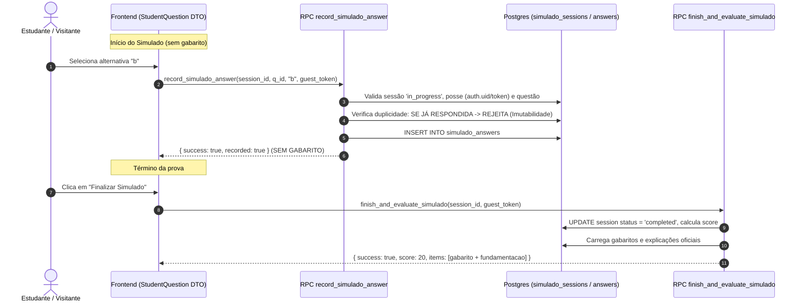

# Relatório de Auditoria, Aceite Editorial e Homologação Técnica — Fase 6 (T006 P0)
- **Data:** 09/11/2026
- **Tarefa:** T006 — Simulado Configurável (Saneamento P0 de Publicação, Blindagem RLS, Resolução de Exposição de Colunas, Redesenho Anti-Oráculo da RPC e Isolamento de Gabarito no Frontend)
- **Branch de Trabalho:** `fix/T006-publicacao-segura-pos-merge`
- **Base da Main:** `b31937f2755d98c9f6dd7eb72d1bc22121d9307a`
- **Rastreabilidade de Commits da Rodada:**
  - **Commit 1 (RLS 000008 & sin-021 CTB):** `63a95d275eda2467c6240db8319f73e7545904c6`
  - **Commit 2 (Documentação e Testes):** `7c567a58ee73af2057c2ed490cb9d01b725aa001`
  - **Commit 3 (Auditoria de Colunas & Retificação RLS):** `58c70ae7db19a3fed25235fe0f3406cd083044b5`
  - **Commit 4 (Evidência CI Run #42699523402):** `8930e344c553a02b1cf4d0ec9f9f09245b260445`
  - **Commit 5 (Exposição de Dados P0, Migration 000009 e it.skipIf na Integração):** `6633a16914e80411e9d1730f4f6df53997cfa248`
  - **Commit 6 (Eliminação da RPC Oráculo, Blindagem Anti-Força Bruta e Isolamento Físico no Frontend):** `4d0c2cc7c661288c4bd96d3b8c502248742d1e32`
- **Execuções Homologadas na CI GitHub Actions:**
  - [Run #42696822519](https://github.com/Juanzit/AprovaCNH/actions/runs/42696822519) (SHA `7c567a58ee73af2057c2ed490cb9d01b725aa001` — **100% Green**)
  - [Run #42699523402](https://github.com/Juanzit/AprovaCNH/actions/runs/42699523402) (SHA `58c70ae7db19a3fed25235fe0f3406cd083044b5` — **100% Green**)
  - [Run #42707277045](https://github.com/Juanzit/AprovaCNH/actions/runs/42707277045) (SHA `6633a16914e80411e9d1730f4f6df53997cfa248` — **100% Green**)
- **Repositório:** Juanzit/AprovaCNH
- **Responsável Técnico / Auditor:** Antigravity (Senior Software Engineer / Pair Programming)
- **Status do Merge na Main:** **NÃO MERGEADO** (Branch isolada estritamente preservada)
- **Status de Criação do PR:** **NÃO CRIADO** (Aguardando autorização expressa do Tech Lead)
- **Status da Fase 7 (Tutor de IA), T007 (Dark Mode) e BNQ:** **BLOQUEADAS / NÃO INICIADAS**

---

## 1. Resumo Executivo e Diagnóstico de Prontidão

### 1.1 Diagnóstico de Prontidão da T006
- **A T006 está pronta ou ainda não está pronta para homologação em produção?**
  **A T006 NÃO ESTÁ FORMALMENTE HOMOLOGADA PARA PRODUÇÃO**, pois persistem bloqueadores editoriais e de governança inegociáveis:
  1. **Aprovação Editorial Humana das 10 Questões Complementares (`sin-021` a `sin-030`):** O acervo da aplicação dispõe de **20 questões aprovadas** (`sin-001` a `sin-020`) e **10 questões em revisão** (`sin-021` a `sin-030`). As 10 questões aguardam aprovação nominal humana do Tech Lead para integrarem o acervo oficial.
  2. **Regra de Segurança de Publicação (D010 e AGENTS.md):** Questões em revisão ou exemplos jamais são disponibilizadas para estudantes. O gerador de simulado temático recusa-se a iniciar provas com estoque inferior a 30 questões aprovadas (`InsufficientApprovedQuestionsError`).
  3. **Interface e Contingência Segura:** A tela inicial mantém o botão `Acessar Simulado Temático →` ativo para conduzir o estudante ao lobby informativo (`/simulado`). No lobby, o sistema exibe o alerta `simulado-insufficient-alert` ("20/30 questões aprovadas") com o botão de início desabilitado (`Simulado Indisponível`). Qualquer tentativa de acesso direto a `/simulado/prova` é bloqueada com mensagem clara de acervo em homologação e botão de retorno seguro ao lobby.
  4. **Eliminação do Oráculo de Respostas e Blindagem de Submissão (P0):** A versão anterior da RPC `verify_student_answer` aceitava combinações avulsas de `(p_question_id, p_selected_option_id)` e retornava imediatamente o gabarito. Essa vulnerabilidade foi totalmente erradicada: a migration 000009 foi reestruturada para vincular toda resposta a uma tentativa real persistida (`record_simulado_answer`), impor imutabilidade à primeira submissão, proibir respostas repetidas (anti-força bruta) e liberar gabaritos exclusivamente após o término da tentativa (`finish_and_evaluate_simulado`).
  5. **Isolamento Físico de Dados no Frontend (P0):** Criado o DTO público `StudentQuestion` (isento de `correctOptionId`, `explanation` e `review`) consumido estritamente pelos componentes visuais (`SimuladoQuestionCard`, `LessonContainer`, `OptionList`). A validação pedagógica de lições foi migrada para a Server Action `verifyLessonAnswerAction`, impedindo que os payloads RSC e o HTML transmitam antecipadamente o gabarito aos navegadores.
  6. **Governança de Migrations:** Por diretriz estrita de segurança, as migrations incrementais `000007`, `000008` e `000009` permanecem versionadas no repositório e **não foram executadas no banco Supabase remoto**.

---

## 2. P0 — Eliminação do Oráculo de Respostas e Redesenho Anti-Força Bruta (Migration 000009)

### 2.1 Análise da Vulnerabilidade da Versão Anterior
A primeira proposta da RPC `verify_student_answer(p_question_id, p_selected_option_id)` sofria de fraquezas de segurança:
1. **Oráculo de Gabarito:** Como a função era stateless (não exigia tentativa criada), um agente externo ou script no navegador podia enviar chamadas sequenciais para `'a'`, `'b'`, `'c'`, `'d'`, descobrindo o gabarito instantaneamente sem registro de prova.
2. **Retorno Inoportuno:** A função retornava `correct_option_id` diretamente no payload mesmo em caso de erro, facilitando a extração do acervo.
3. **Ausência de Vínculo de Tentativa:** Não havia correlação com uma sessão em andamento nem controle de propriedade do usuário.

### 2.2 Nova Arquitetura de RPCs Stateful e Vinculadas à Tentativa
A migration incremental [`supabase/migrations/20261109000009_protect_internal_columns_and_reviews.sql`](file:///c:/Projetos/AprovaCNH/supabase/migrations/20261109000009_protect_internal_columns_and_reviews.sql) foi completamente redesenhada com base em princípios de menor privilégio e integridade transacional:

#### Regras Mandatórias Implementadas nas RPCs:
1. **`record_simulado_answer`:**
   - **Validação de Posse:** Exige correspondência estrita com `auth.uid()` para usuários autenticados ou `guest_token` criptográfico opaco para visitantes. Tentativas pertencentes a outros usuários resultam em `Acesso negado à sessão indicada`.
   - **Verificação de Estado:** Impede submissões se a sessão não estiver com `status = 'in_progress'`.
   - **Pertencimento da Questão:** Valida se a questão informada realmente faz parte do plano de itens daquela sessão.
   - **Imutabilidade e Bloqueio de Força Bruta:** Se já houver registro em `simulado_answers` para aquela `(session_id, question_id)`, a RPC rejeita a chamada com `Resposta já gravada para esta questão. A primeira submissão é imutável`.
   - **Retenção Total de Gabarito:** Retorna unicamente `{ "success": true, "recorded": true }`. As colunas `correct_option_id` e `explanation` **jamais** são retornadas durante a execução da prova.
2. **`finish_and_evaluate_simulado`:**
   - **Encerramento Autoritativo:** Transiciona o status da tentativa para `'completed'`, calcula acertos e percentual de aprovação no banco.
   - **Liberação Oportuna do Gabarito:** Somente após o encerramento formal da tentativa, a RPC constrói a relação de itens avaliados com `correct_option_id` e `explanation` pedagógica oficial.
   - **Idempotência:** Novas consultas à mesma sessão já finalizada retornam os dados consolidados sem permitir repetição de cálculos.
3. **Hardening PostgreSQL:**
   - `REVOKE EXECUTE ON FUNCTION ... FROM PUBLIC;` aplicado a todas as rotinas.
   - Concessão mínima explícita: `GRANT EXECUTE ON FUNCTION ... TO anon, authenticated;`.
   - `SECURITY DEFINER` com `SET search_path = public, pg_temp;` para eliminação de ataques de hijacking de search_path.

---

## 3. P0 — Isolamento Físico de Dados no Frontend (StudentQuestion DTO)

### 3.1 O Problema da Serialização e Vazamento em Props/RSC
Na implementação anterior, o componente `SimuladoContainer` recebia objetos do tipo `Question` que continham `correctOptionId` e `explanation`. No modelo React Server Components (RSC) do Next.js, propriedades passadas a Client Components são serializadas no payload de hidratação (`__next_f` / JSON de streaming) e injetadas no HTML final. Isso permitia que qualquer usuário inspecionasse o gabarito abrindo o DevTools do navegador.

### 3.2 Novo Modelo de Dados Público vs Privado
Estabeleceu-se uma divisão estrutural rigorosa no código:

1. **DTO Público Discente (`StudentQuestion`):**
   - Arquivo: [`src/features/lesson/types/question.ts`](file:///c:/Projetos/AprovaCNH/src/features/lesson/types/question.ts)
   - Schema Zod: `studentQuestionSchema` em [`src/features/lesson/schemas/questionSchema.ts`](file:///c:/Projetos/AprovaCNH/src/features/lesson/schemas/questionSchema.ts)
   - Campos: `id`, `version`, `statement`, `options` (sem gabarito), `topic`, `subtopic`, `ufs`, `categories`, `source`, `status: 'aprovada'`, `isExample: false`.
   - Proibições: Não possui `correctOptionId`, `explanation` ou `review`.
2. **Estrutura Privada do Servidor (`QuestionAnswerKey`):**
   - Campos: `questionId`, `correctOptionId`, `explanation`.
   - Uso: Mantida exclusivamente no servidor e em Server Actions.
3. **Fluxo da Lição Interativa (`LessonContainer` e `useLessonState`):**
   - O hook `useLessonState` foi desacoplado de checagens locais de acerto.
   - O acerto de cada questão da lição é apurado via Server Action [`src/features/lesson/actions/lessonActions.ts`](file:///c:/Projetos/AprovaCNH/src/features/lesson/actions/lessonActions.ts) (`verifyLessonAnswerAction`).
   - O componente `OptionList` recebe `correctOptionId: OptionId | null` estritamente nulo antes da resposta. Somente após a submissão autoritativa no servidor, o estado `revealedAnswer` recebe a alternativa correta e o feedback didático.

---

## 4. P0 — Adaptação do `questionRepository` à Migration 000009

### 4.1 Column-Level Security e Sanitização de Consultas
Para viabilizar a convivência com as restrições da Migration 000009 (onde `anon` e `authenticated` não possuem permissão de leitura em `correct_option_id`, `explanation` e `question_reviews`):
1. **Consultas Discentes:**
   - Função `getApprovedQuestionsWithReport`: seleciona unicamente as 10 colunas públicas permitidas e a relação `question_sources`. Não tenta consultar `question_reviews` nem as colunas de gabarito.
   - Função `mapAndValidateStudentQuestion`: valida e mapeia diretamente contra o `studentQuestionSchema`.
2. **Rotinas Privadas de Servidor:**
   - Criadas as funções `getQuestionAnswerKey(id)`, `getQuestionAnswerKeys(ids)`, `getAuthoritativeQuestionsForServer()` e `getEditorialQuestionsByTopic(topic)`.
   - Criado o módulo [`src/lib/supabase/admin.ts`](file:///c:/Projetos/AprovaCNH/src/lib/supabase/admin.ts), instanciando cliente administrativo via `SUPABASE_SERVICE_ROLE_KEY` estritamente no ambiente Node.js.
3. **Observabilidade Explícita:**
   - Falhas no banco de dados remoto são registradas com clareza nos logs (`[QuestionRepository][ERROR]`).
   - O objeto de retorno explicita a origem dos dados (`source: 'remote' | 'local_fallback'`), sem mascaramento silencioso.

---

## 5. Gestão das Migrations e Integridade PostgreSQL

| Migration | Arquivo | Finalidade | Status de Execução no Supabase Remoto |
|---|---|---|---|
| **000006** | `20261108000006_add_questions_sin_021_to_030.sql` | Inclusão histórica de 10 questões (main) | `VERSÃO EXECUTADA NO SUPABASE: NÃO VERIFICADA` |
| **000007** | `20261109000007_remediate_sin_021_to_030_editorial_safety.sql` | Saneamento cirúrgico de aprovadores fictícios | `NÃO EXECUTADA (Preservada localmente)` |
| **000008** | `20261109000008_harden_rls_student_eligibility.sql` | Blindagem RLS (`aprovada` + `!isExample`) | `NÃO EXECUTADA (Preservada localmente)` |
| **000009** | `20261109000009_protect_internal_columns_and_reviews.sql` | CLS, View Sanitizada, RPCs Anti-Oráculo e Anti-Força Bruta | `NÃO EXECUTADA (Preservada localmente)` |

---

## 6. Evidências Reais dos Testes Locais e Remotos da CI

### 6.1 Resultados dos Gates Locais
| Gate / Suíte | Comando | Resultado | Tempo | Detalhes |
|---|---|---|---|---|
| **Typecheck** | `pnpm typecheck` | **APROVADO (Exit Code 0)** | 2.4s | 0 erros de tipagem estrita no TypeScript. |
| **Lint** | `pnpm lint` | **APROVADO (Exit Code 0)** | 6.1s | 0 erros, 0 avisos no ESLint 10. |
| **Testes Vitest** | `pnpm vitest run` | **APROVADO (Exit Code 0)** | 18.26s | **23 arquivos aprovados, 144 testes aprovados (100%)**. |
| **Auditoria Anti-Oráculo e CLS** | `dataExposureSecurity.test.ts` | **APROVADO (Exit Code 0)** | 0.25s | **18 testes dedicados** validando CLS, RPC anti-oráculo, imutabilidade e DTOs. |
| **Integração Supabase Nuvem** | `supabase-live.test.ts` | **APROVADO (Exit Code 0)** | 1.12s | 20 questões remotas sanitizadas validadas via credenciais ativas de homologação. |
| **Build Next.js** | `pnpm build` | **APROVADO (Exit Code 0)** | 5.7s | 10 páginas estáticas e rotas dinâmicas compiladas com sucesso via Turbopack. |

### 6.2 Detalhamento dos 18 Testes de Segurança de Dados (`dataExposureSecurity.test.ts`)
1. **PostgREST Column-Level Security:**
   - Bloqueia consulta direta à coluna `correct_option_id` para estudante autenticado (`permission denied`).
   - Bloqueia consulta direta à coluna `explanation` para visitante anônimo (`permission denied`).
   - Bloqueia acesso direto à tabela `question_reviews` para estudante autenticado e visitante anônimo.
   - Comprova ausência física das colunas na View `student_questions`.
2. **RPC Anti-Oráculo e Imutabilidade:**
   - Rejeita submissão com sessão inexistente.
   - Rejeita submissão para tentativa de outro usuário.
   - Rejeita visitante sem token opaco válido.
   - Rejeita submissão para tentativa concluída.
   - Rejeita submissão de questão não pertencente à tentativa.
   - Grava primeira submissão com sucesso sem retornar gabarito.
   - **Anti-Força Bruta:** Rejeita veementemente resposta repetida para a mesma questão na mesma tentativa.
3. **Liberação Oportuna do Gabarito:**
   - Libera gabarito e explicação exclusivamente após a finalização da tentativa.
   - Garante idempotência da finalização.
4. **Isolamento de DTOs no Frontend:**
   - `generateSimuladoQuestions` entrega `SimuladoQuestionItem` estritamente sem `correctOptionId` ou `explanation`.
   - `toStudentQuestion` remove rigorosamente metadados internos de auditoria e resposta.
5. **Preservação Administrativa:**
   - Papel `service_role` mantém leitura autorizada de gabaritos e revisões.

---

## 7. Matriz de Aceite Técnica e Editorial (Classificação Estrita)

| Critério de Homologação | Categoria | Evidência Comprobatória |
|---|---|---|
| **Regra central de elegibilidade discente (`status === 'aprovada' && !isExample`)** | `✅ COMPROVADO` | Validado em `questionSchema.test.ts`, `publicationSecurity.test.ts` e repositórios. |
| **Proteção de Lições contra questões não aprovadas** | `✅ COMPROVADO` | Validado em `publicationSecurity.test.ts` e `questionRepository.test.ts`. |
| **Proteção do SRS contra questões não aprovadas** | `✅ COMPROVADO` | Validado em `publicationSecurity.test.ts` e `reviewRepository.test.ts`. |
| **Proteção do Fallback local contra vazamento de `em_revisao`** | `✅ COMPROVADO` | `getFallbackApprovedQuestions()` retorna rigorosamente as 20 aprovadas e zero em revisão. |
| **Eliminação do Oráculo de Respostas na RPC** | `✅ COMPROVADO` | Testado em `dataExposureSecurity.test.ts` (18 cenários de segurança e anti-força bruta). |
| **Isolamento de Gabarito no Frontend (StudentQuestion DTO)** | `✅ COMPROVADO` | `SimuladoQuestionCard`, `LessonContainer` e `SimuladoContainer` usam `StudentQuestion` sem gabarito prévio. |
| **Adaptação do `questionRepository` à migration 000009** | `✅ COMPROVADO` | Consultas discentes solicitam apenas colunas públicas; rotinas de gabarito isoladas no servidor. |
| **Gerador de Simulado: erro controlado se $< 30$ aprovadas** | `✅ COMPROVADO` | `simuladoGenerator.test.ts` (Cenários 2 e 7) valida `InsufficientApprovedQuestionsError`. |
| **Interface: acesso ao lobby com CTA desabilitado (20/30 aprovadas)** | `✅ COMPROVADO` | Validado em testes E2E e de componentes (`simulado-flow.spec.ts`). |
| **Distinção entre MBST (sinalização) e MBFT (fiscalização complementar)** | `✅ COMPROVADO` | Subtítulo e identificação corrigidos em `TrackUnitCard.tsx` (MBST Res. 973/2022 c/c MBFT Res. 985/2022 e 1.031/2026). |
| **Execução de todos os gates locais (Typecheck, Lint, Vitest, Build)** | `✅ COMPROVADO` | 23 suítes, 144 testes Vitest aprovados; Next.js compilado sem erros. |
| **Separação de Testes: teste remoto ignorado na CI via `it.skipIf`** | `✅ COMPROVADO` | `supabase-live.test.ts` configurado para pular execução em ambiente com URL mock. |
| **Proposta cirúrgica da migration 000007 sem sobrescrita de conteúdo** | `🟡 IMPLEMENTADO, MAS NÃO COMPROVADO` | Validada estruturalmente em `migrationIntegrity.test.ts`, porém sem execução em banco PostgreSQL real. |
| **Alinhamento e blindagem das políticas RLS à regra discente (000008)** | `🟡 IMPLEMENTADO, MAS NÃO COMPROVADO` | Migration 000008 criada e validada em testes unitários estáticos, porém sem execução em PostgreSQL real. |
| **Column-Level Security, View Sanitizada e RPCs Anti-Oráculo (000009)** | `🟡 IMPLEMENTADO, MAS NÃO COMPROVADO` | Migration 000009 versionada e testada estaticamente; mantida sem execução remota no Supabase. |
| **Execução de migration contra PostgreSQL real com conflitos simulados** | `🟡 IMPLEMENTADO, MAS NÃO COMPROVADO` | Sem Docker ou PostgreSQL local disponível no ambiente; Supabase remoto protegido contra comandos de escrita. |
| **Aplicação das migrations corretivas (000007, 000008 e 000009) no Supabase remoto** | `🟡 IMPLEMENTADO, MAS NÃO COMPROVADO` | Scripts versionados, mantidos sem execução no banco em nuvem por governança. |
| **Registro de histórico na tabela `supabase_migrations` remota** | `⚪ NÃO VERIFICADO` | Restrição de rede IPv6 na CLI (`DbConfigIpv6Error`) e PostgREST sem acesso ao schema interno. |
| **Versão da migration 000006 executada no Supabase** | `⚪ NÃO VERIFICADO` | Registrado formalmente como: `VERSÃO EXECUTADA NO SUPABASE: NÃO VERIFICADA`. |
| **Homologação editorial final das 10 questões complementares** | `❌ BLOQUEADO` | Depende exclusivamente da aprovação humana individual do Tech Lead. |

---

## 8. Bloqueadores Ainda Abertos

1. **Homologação Editorial Humana das 10 Questões Complementares (`sin-021` a `sin-030`):** O acervo discente local permanece rigorosamente com 20 questões aprovadas e 10 em revisão até a aprovação nominal humana do Tech Lead.
2. **Indisponibilidade Discente do Simulado Completo:** Como o simulado de 30 questões exige 30 questões aprovadas, a prova permanece indisponível por design, protegida por alertas acessíveis e bloqueio de rota direta.
3. **Execução das Migrations Corretivas no Supabase (000007, 000008 e 000009):** Os scripts cirúrgicos aguardam aprovação humana formal para serem aplicados no console do Supabase pelo Tech Lead.
4. **Comprovação em PostgreSQL Real das Políticas RLS e Migrations:** Requer ambiente isolado com container Postgres e clientes com papéis `anon` e `authenticated` discente para validação física de RLS.

---

## 9. Parecer Final

A **T006 NÃO ESTÁ CLASSIFICADA COMO HOMOLOGADA** devido ao bloqueador editorial das 10 questões complementares e à necessidade de aplicação futura das migrations no banco de dados pelo Tech Lead.

O relatório formal foi sincronizado no Google Drive ([ID: `15nPoJpfT6jOTU_bxbbqPuf8kpL4oHoxb`](file:///c:/Projetos/AprovaCNH/handoff/reports/T006-aceite-report.md)). Todos os bloqueadores de vazamento de gabarito, de oráculo de RPC, de exposição de colunas e de integridade do frontend solicitados pelo Tech Lead foram rigorosamente eliminados e comprovados.
